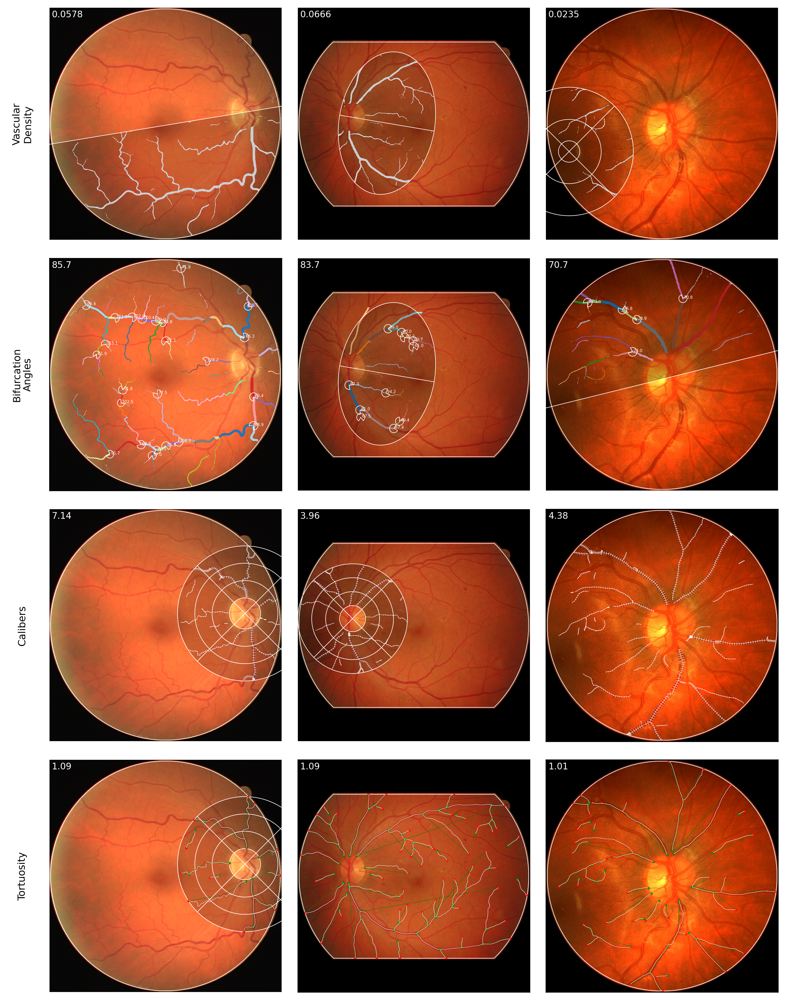
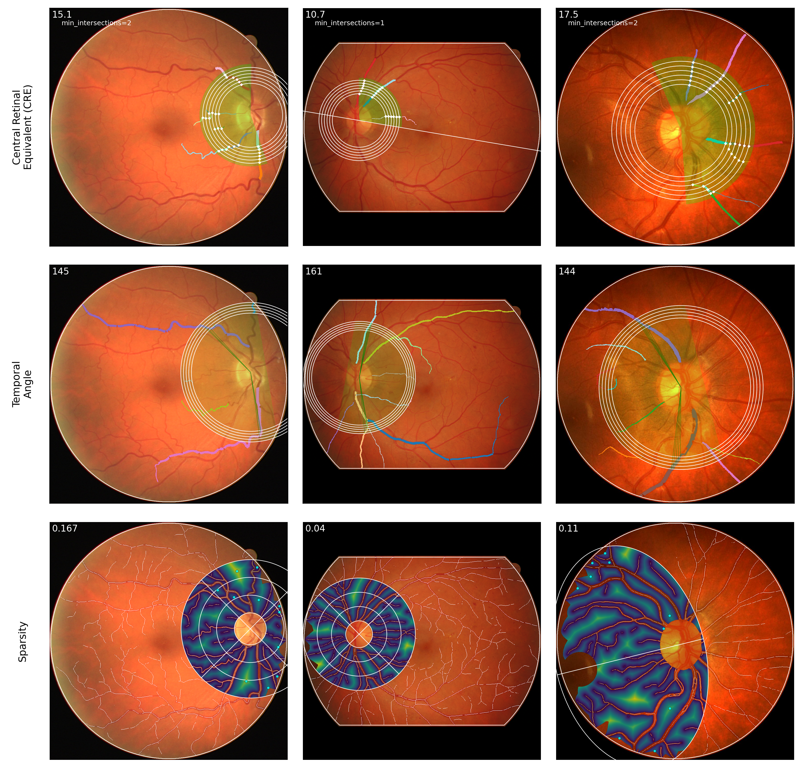

## Updates
- 01/10/2026: New CRE implementation that follows the [ARIC vessel measurement manual.](https://aric.cscc.unc.edu/aric9/sites/default/files/public/visitdocuments/v5/14b1%20ARIC%20NCS%20VM%20Protocol%2011.23.10.pdf#page=17).
- 12/09/2026: New [VascX app available](https://eyened.github.io/retinalysis-vascx-app/). It runs VascX in the browser using GPU and visualizes biomarkers. Running time is about ~10s per image on a Mac M4/M5 laptop, and much slower on CPU. It is meant as a demo and for small runs with <500 images. For best performance on larger sets, use the Python package with a GPU.
- 12/09/2026: New convnextv2 segmentation models are available and they are the new default models in VascX. They have better performance and run faster than the previous UNet ensembles.
- 10/06/2026: Updated README with more complete information on interpreting outputs and advanced use cases.
- 04/06/2026: We have fixed some remaining missing dependencies that meant run-models was not working correctly with vascx.

## VascX retinal vascular analysis

VascX was created to facilitate the extraction of retinal vascular biomarkers from color fundus image (CFI) segmentations. The instructions in this repository explain how to run the entire pipeline, which has two main parts:
- **CFI Segmentation.** Extraction of optic disc, vessels and artery vein segmentation and fovea locations. Our model weights are publicly available in a [huggingface repository](https://huggingface.co/Eyened/vascx). See instructions below for inference.
- **Biomarker computation.** Extraction of biomarkers from the segmentations.

## Features

- Currently supported biomarkers / features: Central Retinal Equivalents, Calibers, Artery-Vein Ratio, Vascular Density, Bifurcation Angles, Tortuosity, Sparsity, and others.
- Many of these biomarkers support multiple implementations and configuration arguments as detailed in [our manuscript](https://arxiv.org/abs/2602.08580). The code for each biomarker also specificies the supported options.
- VascX supports region-aware measurements, relative to the optic disc - fovea axis. If the region is not visible, the biomarker is not computed.
- VascX can generate visualisations for every biomarker.

<!-- <p align="center">
  
  
</p> -->

## Installation

To install the entire fundus analysis pipeline including fundus preprocessing, model inference code and vascular biomarker extraction:

1. Create a virtual environment, or otherwise ensure a clean environment.

2. Install torch and torchvision that match your cuda environment. For example:
```
pip install torch torchvision torchaudio  # pip and CUDA 12
conda install pytorch torchvision torchaudio pytorch-cuda=12.1 -c pytorch -c nvidia # conda and CUDA 12
pip install torch torchvision torchaudio --index-url https://download.pytorch.org/whl/cu118 # pip and CUDA 11
conda install pytorch torchvision torchaudio pytorch-cuda=11.8 -c pytorch -c nvidia # conda and CUDA 11
```

3. Install VascX:

```
pip install retinalysis-vascx
```

> [!TIP]
> To be able to directly modify VascX code to eg. customise biomarkers or develop new ones, clone and install the Python package in development mode instead:
> ```
> git clone git@github.com:Eyened/retinalysis-vascx.git rtnls_vascx
> cd rtnls_vascx
> pip install -e .
> ```


## Usage

To run the two stages of VascX on a folder with input CFIs:

```
vascx run-models <PATH_TO_IMAGES> <PATH_TO_FOLDER_FOR_SEGMENTATIONS>
vascx calc-biomarkers <PATH_TO_FOLDER_FOR_SEGMENTATIONS> <PATH_TO_BIOMARKER_REPORT> --feature-set od_centered --n-jobs 8
```

> [!TIP]
> Use `vascx run-models --help` or `vascx calc-biomarkers --help` to get help.

- `PATH_TO_IMAGES` should point to a folder with input CFIs in standard imaging formats. DICOM is supported via `pydicom`. Alternatively `PATH_TO_IMAGES` may be the path to a CSV file with `id` and `path` columns, and one image per row. If provided in this way, each `path` should be an absolute path to a valid image file and the corresponding unique `id` will be used to name the output and intermediate results for that image. This is useful when the source images are not all in a single folder.

  <details>
  <summary>Sample CSV file with inputs</summary>
  
  If you chose to use a CSV file as input to `run-models`, the format should be the following:
  ```
  id,path
  drive_left_22,/path/to/samples/fundus/original/DRIVE_22.png
  drive_right_40,/path/to/samples/fundus/original/DRIVE_40.png
  chasedb_left_08,/path/to/samples/fundus/original/CHASEDB1_08L.png
  chasedb_right_12,/path/to/samples/fundus/original/CHASEDB1_12R.png
  hrf_green_04,/path/to/samples/fundus/original/HRF_04_g.jpg
  hrf_dr_07,/path/to/samples/fundus/original/HRF_07_dr.jpg
  ```
  
  Note that paths should be absolute and IDs should be unique.
  </details>

- The folder `PATH_TO_FOLDER_FOR_SEGMENTATIONS` should initially be an empty or non-existent folder. The first stage (`run-models`) will write intermediate segmentations and other AI outputs to this folder.
- The same folder should be passed to the second stage as input as shown above. 
- `PATH_TO_BIOMARKER_REPORT` is an output folder containing the biomarker values, metadata, README, manifest, and sample plots.
- The `--feature-set` is used to specify a set of biomarkers to extract. The underscore spelling `--feature_set` remains available as an alias.
- The `--n-jobs` option indicates how many CPU jobs to start. For optimal performance, we recommend to set to the number of CPU threads available divided by two, as a rule of thumb.
- By default, `run-models` picks the first available CUDA GPU, Apple MPS acceleration, or CPU. Override this with `--device`, passing any string accepted by `torch.device` (for example `cuda:0`, `mps`, or `cpu`).
- An optional `--logfile PATH_TO_LOGFILE_TXT` can be added to store warnings.

### Example 

For example, to run VascX on the provided samples folder in our git repository:

```
git clone git@github.com:Eyened/retinalysis-vascx.git rtnls_vascx
cd rtnls_vascx
vascx run-models ./samples/fundus/original/ ./samples/fundus/segmentations
vascx calc-biomarkers ./samples/fundus/segmentations ./samples/fundus/biomarker_report --feature-set od_centered --n-jobs 8 --naming resolved
```

## Attribution

If you use VascX, please consider citing our open access papers / preprints:

- [retinalysis-vascx: An explainable software toolbox for the extraction of retinal vascular biomarkers](https://arxiv.org/abs/2602.08580)
Vargas Quiros, J. V., Beyeler, M. J., Vela, S. O., Center, E. R., Bergmann, S., Klaver, C. C. W., & Liefers, B. (2026). retinalysis-vascx: An explainable software toolbox for the extraction of retinal vascular biomarkers. arXiv preprint arXiv:2602.08580.

- [VascX Models: Deep Ensembles for Retinal Vascular Analysis From Color Fundus Images](https://tvst.arvojournals.org/article.aspx?articleid=2810436)
Vargas Quiros, J. D., Liefers, B., van Garderen, K. A., Vermeulen, J. P., & Klaver, C. C. W. (2025). VascX Models: Deep Ensembles for Retinal Vascular Analysis From Color Fundus Images. Translational Vision Science & Technology, 14(7), 19-19.

> [!NOTE]
> The segmentation models for VascX rely not only on owr own datasets but also datasets kindly made publicly available for research purposes. If you use VascX segmentation models, please consider acknowledging some of this valuable work.

## License

Copyright (c) 2025 Erasmus Medical Center.

retinalysis-vascx is available under the [PolyForm Noncommercial License 1.0.0](LICENSE).
Uses outside the permissions granted by that license require a separate commercial agreement. For commercial licensing, contact [Jose Vargas](mailto:j.vargasquiros@erasmusmc.nl).

Third-party components retain their respective licenses and copyright notices, including the BSD-2-Clause notices in the RPS modules and the [license for the bundled sknw code](vascx/shared/sknw/LICENSE).
