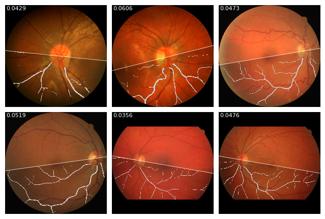
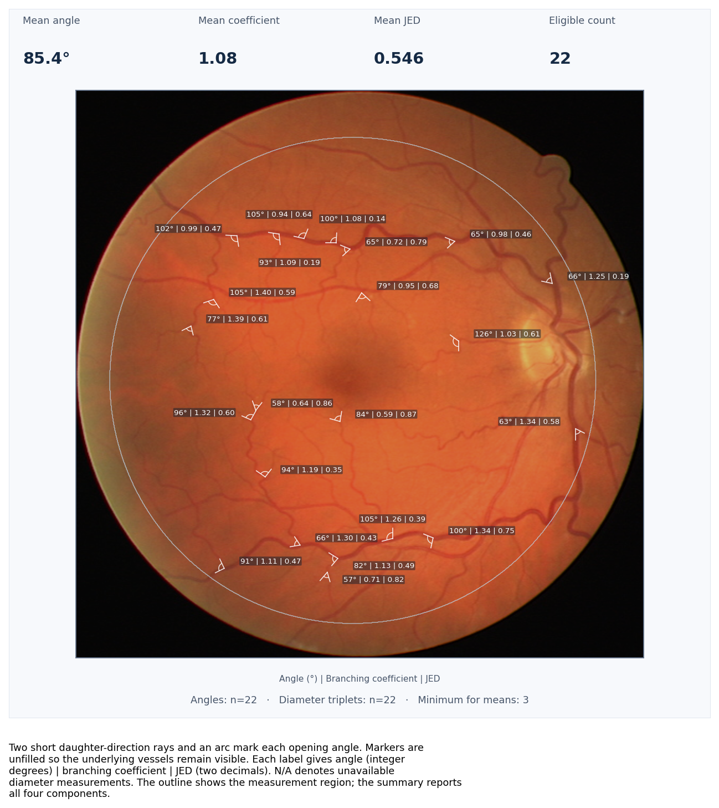
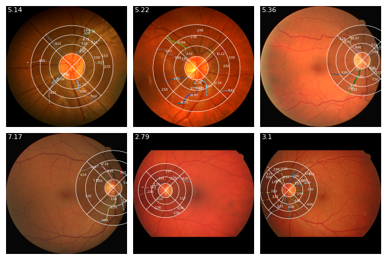
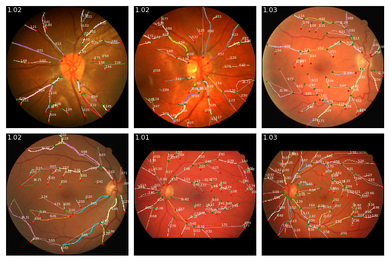
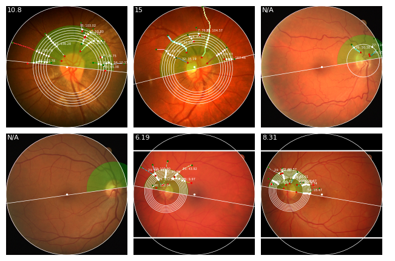
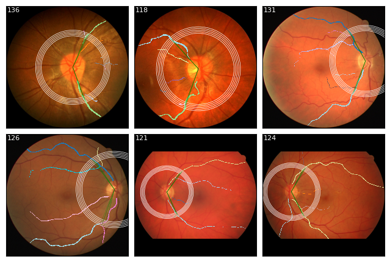
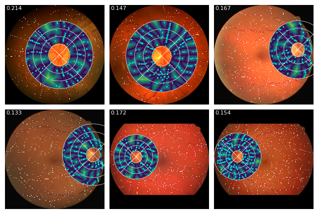
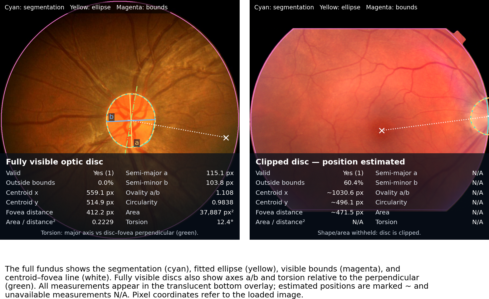

## Updates
- 01/10/2026: New CRE implementation that follows the [ARIC vessel measurement manual.](https://aric.cscc.unc.edu/aric9/sites/default/files/public/visitdocuments/v5/14b1%20ARIC%20NCS%20VM%20Protocol%2011.23.10.pdf#page=17).
- 12/09/2026: New [VascX app available](https://eyened.github.io/retinalysis-vascx-app/). It runs VascX in the browser using GPU and visualizes biomarkers. Running time is about ~10s per image on a Mac M4/M5 laptop, and much slower on CPU. It is meant as a demo and for small runs with <500 images. For best performance on larger sets, use the Python package with a GPU.
- 12/09/2026: New convnextv2 segmentation models are available and they are the new default models in VascX. They have better performance and run faster than the previous UNet ensembles.
- 10/06/2026: Updated README with more complete information on interpreting outputs and advanced use cases.
- 04/06/2026: We have fixed some remaining missing dependencies that meant run-models was not working correctly with vascx.

## VascX retinal vascular analysis

VascX was created to facilitate the extraction of retinal vascular biomarkers from color fundus image (CFI) segmentations. The instructions in this repository explain how to run the entire pipeline, which has two main parts:
- **CFI Segmentation.** Extraction of optic disc, vessels and artery vein segmentation and fovea locations. Our model weights are publicly available in a [huggingface repository](https://huggingface.co/Eyened/vascx). See instructions below for inference.
- **Biomarker computation.** Extraction of biomarkers from the segmentations.

## Features

- Currently supported biomarkers / features: Central Retinal Equivalents, Calibers, Artery-Vein Ratio, Vascular Density, Bifurcation Angles, Tortuosity, Sparsity, and others.
- Many of these biomarkers support multiple implementations and configuration arguments as detailed in [our manuscript](https://arxiv.org/abs/2602.08580). The code for each biomarker also specificies the supported options.
- VascX supports region-aware measurements, relative to the optic disc - fovea axis. If the region is not visible, the biomarker is not computed.
- VascX can generate visualisations for every biomarker.

<!-- <p align="center">
  
  
</p> -->


## Attribution

If you use VascX, please consider citing our open access papers / preprints:
- [VascX Models: Deep Ensembles for Retinal Vascular Analysis From Color Fundus Images](https://tvst.arvojournals.org/article.aspx?articleid=2810436)
Vargas Quiros, J. D., Liefers, B., van Garderen, K. A., Vermeulen, J. P., & Klaver, C. C. W. (2025). VascX Models: Deep Ensembles for Retinal Vascular Analysis From Color Fundus Images. Translational Vision Science & Technology, 14(7), 19-19.

- [retinalysis-vascx: An explainable software toolbox for the extraction of retinal vascular biomarkers](https://arxiv.org/abs/2602.08580)
Vargas Quiros, J. V., Beyeler, M. J., Vela, S. O., Center, E. R., Bergmann, S., Klaver, C. C. W., & Liefers, B. (2026). retinalysis-vascx: An explainable software toolbox for the extraction of retinal vascular biomarkers. arXiv preprint arXiv:2602.08580.


## Installation

To install the entire fundus analysis pipeline including fundus preprocessing, model inference code and vascular biomarker extraction:

1. Create a virtual environment, or otherwise ensure a clean environment.

2. Install torch and torchvision that match your cuda environment. For example:
```
pip install torch torchvision torchaudio  # pip and CUDA 12
conda install pytorch torchvision torchaudio pytorch-cuda=12.1 -c pytorch -c nvidia # conda and CUDA 12
pip install torch torchvision torchaudio --index-url https://download.pytorch.org/whl/cu118 # pip and CUDA 11
conda install pytorch torchvision torchaudio pytorch-cuda=11.8 -c pytorch -c nvidia # conda and CUDA 11
```

3. Install VascX:

```
pip install retinalysis-vascx
```

> [!TIP]
> To be able to directly modify VascX code to eg. customise biomarkers or develop new ones, clone and install the Python package in development mode instead:
> ```
> git clone git@github.com:Eyened/retinalysis-vascx.git rtnls_vascx
> cd rtnls_vascx
> pip install -e .
> ```


## Usage

To run the two stages of VascX on a folder with input CFIs:

```
vascx run-models <PATH_TO_IMAGES> <PATH_TO_FOLDER_FOR_SEGMENTATIONS>
vascx calc-biomarkers <PATH_TO_FOLDER_FOR_SEGMENTATIONS> <PATH_TO_BIOMARKER_REPORT> --feature-set full_v3 --n-jobs 8
```

> [!TIP]
> Use `vascx run-models --help` or `vascx calc-biomarkers --help` to get help.

- `PATH_TO_IMAGES` should point to a folder with input CFIs in standard imaging formats. DICOM is supported via `pydicom`. Alternatively `PATH_TO_IMAGES` may be the path to a CSV file with `id` and `path` columns, and one image per row. If provided in this way, each `path` should be an absolute path to a valid image file and the corresponding unique `id` will be used to name the output and intermediate results for that image. This is useful when the source images are not all in a single folder.

  <details>
  <summary>Sample CSV file with inputs</summary>
  
  If you chose to use a CSV file as input to `run-models`, the format should be the following:
  ```
  id,path
  drive_left_22,/path/to/samples/fundus/original/DRIVE_22.png
  drive_right_40,/path/to/samples/fundus/original/DRIVE_40.png
  chasedb_left_08,/path/to/samples/fundus/original/CHASEDB1_08L.png
  chasedb_right_12,/path/to/samples/fundus/original/CHASEDB1_12R.png
  hrf_green_04,/path/to/samples/fundus/original/HRF_04_g.jpg
  hrf_dr_07,/path/to/samples/fundus/original/HRF_07_dr.jpg
  ```
  
  Note that paths should be absolute and IDs should be unique.
  </details>

- The folder `PATH_TO_FOLDER_FOR_SEGMENTATIONS` should initially be an empty or non-existent folder. The first stage (`run-models`) will write intermediate segmentations and other AI outputs to this folder.
- The same folder should be passed to the second stage as input as shown above. 
- `PATH_TO_BIOMARKER_REPORT` is an output folder containing the biomarker values, metadata, README, manifest, and sample plots.
- The `--feature-set` is used to specify a set of biomarkers to extract. The underscore spelling `--feature_set` remains available as an alias.
- The `--n-jobs` option indicates how many CPU jobs to start. For optimal performance, we recommend to set to the number of CPU threads available divided by two, as a rule of thumb.
- By default, `run-models` picks the first available CUDA GPU, Apple MPS acceleration, or CPU. Override this with `--device`, passing any string accepted by `torch.device` (for example `cuda:0`, `mps`, or `cpu`).
- An optional `--logfile PATH_TO_LOGFILE_TXT` can be added to store warnings.

### Example 

For example, to run VascX on the provided samples folder in our git repository:

```
git clone git@github.com:Eyened/retinalysis-vascx.git rtnls_vascx
cd rtnls_vascx
vascx run-models ./samples/fundus/original/ ./samples/fundus/segmentations
vascx calc-biomarkers ./samples/fundus/segmentations ./samples/fundus/biomarker_report --feature-set full_v3 --n-jobs 8 --naming resolved
```

## Outputs

`vascx calc-biomarkers` writes a self-contained output folder:

```text
PATH_TO_BIOMARKER_REPORT/
├── biomarkers.csv
├── data_dictionary.csv
├── README.md
├── report.json
└── plots/
    └── <variable>/
        └── <image-id>.png
```

`data_dictionary.csv` contains the machine variable, human-friendly display name, description and units for every biomarker, plus image metadata. Without `--sample`, report figures show up to three images for artery/vein features and four for other features. Use `--sample N` to extract biomarkers for a random sample of up to N available images, without repeats, and illustrate the same sample, capped at sixteen images per figure. The default seed is `0`; use `--seed INTEGER` to choose another reproducible sample. If N is at least the number of available images, all images are used. The seed has no effect without `--sample`. For example, `--sample 10` extracts and plots up to ten images; `--sample 20` extracts up to twenty and plots the first sixteen in the selected sample. Repeated `--report-image` options select particular images for the figures within these limits. Use `--no-report` to skip README, manifest, and plot generation while still writing biomarkers and metadata. Existing report-owned outputs are protected unless `--overwrite` is passed.

`biomarkers.csv` also includes `crop_scale_factor`: the number of original-input pixels per processed-image pixel. Multiply pixel lengths by this factor, areas by its square, and divide inverse-pixel measurements (such as curvature) by it to restore the original image scale before applying device conversion factors. For example, a width of 10 processed pixels with a factor of 2 becomes 20 original pixels. The factor is blank if preprocessing scale is unavailable. It refers to the image supplied to VascX and restores scale, not the original coordinate origin of centroids. See the [post-processing notebook](./notebooks/3_post_process.ipynb) for an example using the data dictionary's units. Outputs already calibrated to millimetres include this correction and must not be rescaled again.

By default, CLI output uses feature-set-aware `resolved` names; pass `--naming canonical` to preserve the full canonical convention.
VascX parameter names typically follow the format:

```
[AGGREGATION]_[BIOMARKER]_[COMPONENT]_[PARAMETERS]_[REGION]_[LAYER]
```


For example, for `median_tort_dist_etdrs_arteries`:

```
AGGREGATION = median - the vessel segments are aggregated using the median
BIOMARKER = tort (Tortuosity)
PARAMETERS = dist - this is the distance implementation of tortuosity
REGION = measured over the full ETDRS grid
LAYER = arteries - arterial biomarker - as opposed to veins or vessels (combined)
```

Some of the tokens may be ommited if they match defaults or if they do not apply. `COMPONENT` is present only for compound features, which produce multiple named values instead of a scalar output. For example, `ODMorphology` produces `od_valid`, `od_centroid_x`, and `od_torsion` with resolved naming, or `od_valid_retina`,
`od_centroid_x_retina`, and `od_torsion_retina` with canonical naming. `BackgroundLab` returns `[L*, a*, b*]` together; its existing `background_lab_l`, `background_lab_a`, and `background_lab_b` column names (and their canonical `_retina` variants) are unchanged.

A CSV mapping between the selected biomarker names in the output CSV and publication-friendly display names can be generated with the same `--naming` option:

```
vascx write-mapping --feature_set full_v3 PATH_TO_MAPPING_CSV --naming resolved
```


`vascx run-models` will write segmentations and other model predictions to `PATH_TO_FOLDER_FOR_SEGMENTATIONS`, with the following structure:

```
/path/to/segmentations
  - preprocessed_rgb/ - preprocessed fundus images
  - artery_vein/ - artery-vein model segmentations
  - vessels/ - vessel model segmentations
  - disc/ - optic disc model segmentations
  - overlays/ - optional overlays showing the segmentations
  - bounds.csv - contains the bounds of the fundus image
  - fovea.csv - model predictions of the fovea locations for each image
  - quality.csv - model estimations of CFI quality
```

The folders above will contain images with matching filenames.

## Notebooks

As an alternative, we also provide notebooks for running the three stages:

1. Preprocessing. See [this notebook](./notebooks/0_preprocess.ipynb). This step is CPU-heavy and benefits from parallelization (see notebook).

2. Inference. See [this notebook](./notebooks/1_segment_preprocessed.ipynb). All models can be ran in a single GPU with >10GB VRAM.

3. Feature extraction. See [this notebook](./notebooks/2_feature_extraction.ipynb). This step is CPU-heavy again and benefits from parallelization (see notebook). Advanced users who need to pass custom parameters per image can use the alternative [advanced feature extraction notebook](./notebooks/advanced/2_feature_extraction_advanced.ipynb).

4. Post-processing and normalisation. See our [sample post-processing notebook](./notebooks/3_post_process.ipynb) showing how to post-process, and optionally normalise VascX exports.

> [!IMPORTANT]
> ### Biomarker post-processing and normalisation
> Features measure spatial quantities in pixels. Enable `use_mm_per_pixel=True` to convert lengths, areas and inverse lengths to mm, mm² and mm⁻¹, respectively. The data dictionary describes the exported units. Ratios, angles, counts and Lab values are unchanged. See the run input contract below.

## Advanced Usage

### Offline Usage

By default, `vascx run-models` loads model weights from the [Hugging Face model repository](https://huggingface.co/Eyened/vascx). This is convenient on connected workstations, but it will fail on offline clusters unless the model files are provided locally.

For offline use, download the VascX model files on a machine with internet access, copy them to the cluster, and arrange them in this directory layout:

```
/path/to/vascx-models/
  - quality/
    - quality.pt
  - artery_vein/
    - av_wsoft_patches_02_finetune.pt
  - vessels/
    - vessels_may26.pt
  - disc/
    - disc_may26.pt
  - fovea/
    - fovea_may26.pt
```

Then pass that directory to `run-models`:

```
vascx run-models /path/to/images /path/to/segmentations --model-dir /path/to/vascx-models
```

You can also set the model directory once in the environment:

```
export VASCX_MODEL_DIR=/path/to/vascx-models
vascx run-models /path/to/images /path/to/segmentations
```

For more control, provide individual model files directly with options `--quality-model`, `--av-model`, `--vessels-model`, `--disc-model` and `--fovea-model`. Per-model options take precedence over `--model-dir` and `VASCX_MODEL_DIR`.


### Skipping steps during re-execution

The `run-models` command has several `--no-*` flags that are intended for re-executing part of a pipeline after some outputs already exist. These flags skip work; they do not change where downstream steps look for inputs. If a later step needs an output from a skipped step, that output must already be present in the same `OUTPUT_PATH` layout.

For example, to reuse images that were already preprocessed, place them in the output folder before running `run-models` and pass `--no-preprocess`:

```
/path/to/segmentations
  - preprocessed_rgb/
    - image_001.png
    - image_002.png
```

```
vascx run-models ./samples/fundus/original/ /path/to/segmentations --no-preprocess
```

In `--no-preprocess` mode, model inputs are read from `/path/to/segmentations/preprocessed_rgb/*.png`. Files must be RGB PNG images named `<id>.png`; the `<id>` filename stem is used for all downstream outputs, such as `artery_vein/<id>.png`, `vessels/<id>.png`, `disc/<id>.png`, and rows in `fovea.csv` and `quality.csv`. These images should have the same preprocessed format produced by VascX/fundusprep, namely a square, model-ready fundus crop, normally 1024x1024 pixels.

`DATA_PATH` is still required to be an existing path for CLI compatibility, but when `--no-preprocess` is used its contents are not used as model inputs. If you plan to run `calc-biomarkers` on the output folder, keep or provide the matching `bounds.csv` from preprocessing as well.

The other skip flags follow the same idea:

- `--no-vessels` skips vessel and artery-vein segmentation. Reuse this only when `vessels/<id>.png` and `artery_vein/<id>.png` already exist for the IDs you need downstream.
- `--no-disc` skips optic disc segmentation. Reuse this only when `disc/<id>.png` already exists for the IDs you need downstream.
- `--no-fovea` skips fovea detection. Reuse this only when `fovea.csv` already exists if you will create overlays or run biomarker extraction.
- `--no-quality` skips image quality estimation. Reuse this when `quality.csv` already exists or when you do not need quality predictions.
- `--no-overlay` skips overlay creation. Reuse this when overlays already exist or when visualization overlays are not needed.

Only models for enabled steps are required. For example, a run with `--no-quality --no-fovea` does not need `quality/quality.pt` or `fovea/fovea_may26.pt`. If no local model options are provided, VascX keeps using the default Hugging Face model locations.

### Advanced extraction

For most datasets, the standard [feature extraction notebook](./notebooks/2_feature_extraction.ipynb) and `vascx calc-biomarkers` command are the simplest way to compute biomarkers. Advanced users can create `Retina` objects manually when they need to pass custom parameters per image, such as an explicit scaling factor `mm_per_pixel` from an acquisition platform. The [advanced feature extraction notebook](./notebooks/advanced/2_feature_extraction_advanced.ipynb) is an alternative to `2_feature_extraction.ipynb` that demonstrates this using the sample folder.

`mm_per_pixel` is millimetres per pixel of the **original image supplied to VascX**. VascX adjusts it for preprocessing using `crop_scale_factor` (original pixels per processed pixel). The standard loaders recover this factor from the saved preprocessing bounds, including for existing runs. When constructing a `Retina` manually, pass `crop_scale_factor` explicitly; use `1` only if the image was not resized. Unknown crop scale prevents calibrated extraction rather than assuming that the scales match. Extraction defaults to `use_mm_per_pixel=False, use_fovea=True`. When enabled, calibration must be finite and positive for each image; enabled fovea coordinates must both be finite (outside-image coordinates are allowed). Disabled inputs are ignored. Validation happens during each image’s execution: single-image calls raise `InputContractError`; bulk calls log and skip that image. Missing discs remain measurement failures, with `od_valid=0` and unavailable measurements. With fovea disabled, fovea-dependent measurements are unavailable while independent measurements continue.

Feature `compute()` methods always return native units. Shared output conversion scales caliber, CRE, sparsity, sharpness, and optic-disc lengths by `mm_per_pixel × crop_scale_factor`, optic-disc area by the square of this combined factor, and curvature by its inverse. The existing dictionary and report describe the effective units; names do not change. Explicitly enabled calibration also controls physical grids such as ETDRS. Otherwise their existing 4.75 mm / disc–fovea-distance fallback remains, while measurements stay in pixels.

```python
frame = extract_biomarkers_to_folder(
    images, "macula_centered_rs", "report", use_mm_per_pixel=True, use_fovea=True,
)
```

For the CLI, use `--use-mm-per-pixel --mm-per-pixel-csv calibration.csv` with columns `id,mm_per_pixel`; use `--no-use-fovea` to disable landmarks. The `write-readme` and `write-mapping` commands accept the same unit/landmark switches.

**Measurement definition change (`native-spatial-v2`):** sparsity is now a pixel distance and curvature is mean sampled absolute curvature in inverse pixels. Neither is normalized by disc–fovea distance. Curvature sampling is uniform in the spline parameter, not an arc-length integral. Remove the former `Sparsity(normalize=...)` argument. Regenerate outputs in a fresh release; do not relabel old normalized measurements as pixels. Reports record this definition and the enabled inputs.

### Reconstructed optic-disc geometry

Normal extraction uses the accepted ellipse fitted by `rtnls_enface.OpticDisc`
for complete and partial discs alike. `retina.disc.center` is the reconstructed
center; `disc.circle` has radius `sqrt(a*b)`. Directional landmarks and nearest
boundary distances use the ellipse itself. The observed `disc.mask` and
`disc.center_of_mass` remain available, and vessel exclusion uses the observed mask.

The fit rejects a disc when visible IoU is non-finite or below 0.80, when the
optimizer reaches an extrapolation limit, when ovality (major/minor semi-axis
ratio) is >= 1.5, or when fitting fails. The strict ovality limit also applies to
clipped discs. No area or area/ODFD² acceptance threshold is applied. Visible IoU
compares the filled ellipse with the segmentation only inside the image and
fundus ROI; small contour error cannot override poor overlap. The defaults are
boundary margin 5 px, roundness weight 0.02 and robust-loss scale 2 px.
Invalid fits retain the existing loader behavior: `disc=None`. Contour error,
short arcs, visible fraction and off-image centers alone do not reject a fit.
Accepted clipped discs retain their estimated centroid and disc–fovea distance;
other OD morphology measurements require a fully visible fitted ellipse.

Reconstructed landmarks drive grids, laterality, all CRE variants, temporal
angles and disc–fovea distances. Corrected distance drives inferred ETDRS scaling,
fractional tortuosity splitting and foveal exclusion masks. Curvature and sparsity are
not normalized by this distance. An enabled `mm_per_pixel` controls physical grid scaling. `load_disc(...)` invalidates
dependent caches when replacing or clearing a disc.

There is no shared 25 px disc-margin gate or 15 px center-distance gate. Existing
region-coverage thresholds and vessel eligibility rules still apply. Coverage
includes the entire requested region, including area outside the image canvas.
No uncertainty or rejection-reason fields are added to measurement outputs.

See [the enface geometry API](../rtnls_enface/README.md) and
[the fitting notebook](notebooks/5_fit_optic_disc_ellipses.ipynb) for diagnostics,
observed/reconstructed overlays and the twelve sample fits.

<a id="code-changes"></a>
### Code changes

We welcome advanced users who want to do one of:
- Implement new biomarkers or variants of them
- Develop custom feature sets
- Contribute to the code in any other way

For that we recommend to clone VascX repo and install in development mode (-e flag) in a clean environment:

```
git clone git@github.com:Eyened/retinalysis-vascx.git rtnls_vascx
cd rtnls_vascx
pip install -e .
```

After that, you are able to locally:
- Change or add biomarker implementations by working on the [features folder](./vascx/fundus/features). Biomarkers must 
- Change or add "feature sets", or sets of biomarkers to extract from an image by working on the [feature_sets folder](./vascx/fundus/feature_sets).
- Keep using the extraction notebooks and the `vascx calc-biomarkers` command to run experiments.


## Implementation

VascX processes vessel segmentations through four main stages, each producing different data representations:

- **Input masks**: `np.ndarray[bool]` per layer; optic disc and fovea metadata from segmentation models.

- **Stage 1 - Binary/skeleton**: 
  - `binary`: filled vessel mask after disc masking
  - `binary_nodisc`: vessel mask without disc region
  - `skeleton`: skeletonized vessel centerlines using skimage skeletonization

- **Stage 2 - Undirected graph**: 
  - NetworkX `Graph` with skeleton pixels as nodes
  - `Segment` objects stored on edges containing skeleton points and geometric properties
  - Each segment represents a vessel segment between junction points

- **Stage 3 - Directed digraph**: 
  - NetworkX `DiGraph` with flow direction from optic disc outward
  - `trees`: root nodes representing vessel trees emanating from disc
  - `nodes`: `Endpoint` and `Bifurcation` objects with spatial positions
  - `segments`: directed vessel segments with computed properties (diameter, length, etc.)

- **Stage 4 - Resolved vessels**: 
  - Merged vessel graph after running vessel resolution algorithm
  - `resolved_segments`: final vessel segments after merging short segments
  - Segment-to-pixel mapping for spatial feature computation

Biomarker families use different representations: mask-based features use `binary`; topology features use `digraph` and `nodes`; morphological features use `segments` with computed diameters; spatial features use segment-to-pixel mappings.

## Biomarkers

VascX computes retinal vascular biomarkers from standardized representations (binary masks, undirected/directed graphs, resolved vessels). Below we describe each feature with the exact quantity being estimated and the equations used. Throughout, B denotes the stage‑1 binary vessel mask, S the set of eligible directed segments with lengths \(\ell_i\), and R an analysis region of interest; cardinalities count pixels, and distances are in pixels unless noted.

**VascularDensity.** The fraction of retinal area occupied by vessels in R, computed on the binary mask B:

$$
D = \frac{|B \cap R|}{|R|}.
$$



**FractalDimension.** Generalized dimensions `q=0`, `q=1`, and `q=2` describe
how vessel coverage and vessel-pixel distribution scale with box size. For box
masses $m_i > 0$, let $p_i = m_i / \sum_j m_j$. D0, D1, and D2 are the slopes
against $-\log(s)$ of $\log(N)$, $-\sum_i p_i\log(p_i)$, and
$-\log(\sum_i p_i^2)$, respectively. The dimensions are unitless finite-scale
estimates; no OD-fovea normalization is applied.

Defaults use the filled binary vessel mask, an image-origin-aligned grid, and
powers-of-two box sizes starting at 4 pixels and ending at half the shorter
bounding-box extent of the visible analysis region. At least four scales are
required. All nonempty boxes count, including fully occupied boxes and boxes
crossing the region or image boundary; only vessel pixels inside the region
contribute mass. Explicit grid fields require full coverage by default, using
the existing `min_area_within_bounds` precedence. Empty masks, inadequate coverage,
and insufficient scales return missing values. No rotations, occupancy filtering,
or post-fit ordering/clamping are applied. These choices draw on AutoMorph's
dyadic box counting and PVBM's generalized dimensions but reproduce neither
package exactly. The scale range, mask representation and region must be kept
consistent when comparing estimates.

`FractalDimension(q=0, grid_field=...)` selects one scalar output.
`representation="skeleton"` instead measures centerline pixels (skeletonized
before region clipping); `min_box_size` and `max_box_fraction` configure the
scale range. Nondefault settings appear in canonical names. `get_result(layer)`
returns the three dimensions, box sizes/counts, scale curves, fit coefficients,
R-squared values and any missing-value reason. Results are shared between q
selectors on the same immutable layer. Coarse box sums reuse finer sums; plotting
uses the same cached fits.

Only the **sparsity** feature set includes these features: D0/D1/D2 for arteries
and veins over the whole retina and the existing ellipse, disc-centered and
ETDRS regions. Its D0 panel for each region displays all three values and fits,
alongside a cyan vessel-mask overlay and gold counted boxes at one scale.

**Bifurcation.** One compound feature measures the opening angle, branching coefficient,
absolute cubic junctional exponent deviation (JED), and filtered bifurcation count,
separately for arteries and veins in the configured region.

Daughter directions are obtained from their splines at distance $\delta$ from the
junction. The opening angle is the angle between those two direction vectors.
A bifurcation is eligible when its position lies in the region, both daughters
are longer than $\delta$, and its angle is finite and at most `max_angle`.
Defaults are `delta=20` pixels, `max_angle=135` degrees,
`spline_error_fraction=0.05`, and `min_bifurcations=3`.
Standard grid visibility rules apply, with a default minimum visible fraction of 0.95.

Let $d_0$ be the parent segment's mean diameter and $d_1,d_2$ the daughter
segments' mean diameters. These are **whole-segment means**, using the existing
VascX diameter machinery, not local widths measured at $\delta$.

$$
BC = \frac{d_1^2+d_2^2}{d_0^2}, \qquad
JED = \frac{\sqrt[3]{\left|d_0^3-d_1^3-d_2^3\right|}}{d_0}.
$$

JED is nonnegative, dimensionless, and zero when the diameters satisfy Murray's
cubic relation. It is not the deviation of a numerically fitted junction exponent.

| Output component | Meaning |
| --- | --- |
| `bif_angle_mean` | Arithmetic mean of eligible opening angles, in degrees. |
| `bif_branching_coefficient_mean` | Arithmetic mean of the individual branching coefficients. |
| `bif_jed_mean` | Arithmetic mean of the individual absolute cubic JED values. |
| `bif_count` | Number passing the region, daughter-length, and angle filters. |

Parameter, region, and layer tokens follow these prefixes under the normal naming
conventions. Coefficients are calculated per bifurcation before averaging.
Each mean needs at least `min_bifurcations` observations in its own valid sample.
Unusable diameter triplets do not remove valid angles or reduce the count.
An adequately visible empty region returns count zero and missing means; an
unavailable or insufficiently visible region returns four missing values.

The visualization shows one full fundus image with two short daughter-direction
rays and an arc marking each eligible bifurcation angle. The markers are unfilled,
and an outline shows the measurement region. Compact labels
beside each marker show `angle° | coefficient | JED`: integer angles and two decimal
places for coefficient and JED. Unavailable diameter measurements display `N/A`.
The summary includes all four values and sample sizes.

This feature replaces the fundus `BifurcationAngles` and `BifurcationCount` APIs.
Its count is filtered, unlike the former count of every regional branch point.
`full` and `full_v2` now report mean angles rather than medians. The `bergmann`
set no longer includes a bifurcation measurement. The separate FAZ count is unchanged.



**Caliber.** For each segment $i$, diameters are sampled along a spline fitted to its skeleton by projecting spline normals to the vessel boundary on B. The per‑segment diameter is the median along its arclength. The reported caliber aggregates over eligible segments (length $\ell_i \ge \ell_{\min}$):

$$
C = g\big(\{ d_i : i \in S \}\big),
$$

where \(g\) is a robust statistic (typically the median).



**Tortuosity.** Three complementary measures are provided per segment (or per resolved vessel). Let $L_{\text{arc},i}$ be arclength and $L_{\text{chord},i}$ the end‑to‑end Euclidean distance.

- Distance factor:

$$
T_i^{\text{DF}} = \frac{L_{\text{arc},i}}{L_{\text{chord},i}}.
$$

- Curvature-based measure: mean absolute planar curvature sampled uniformly in the spline parameter $t$ (inverse pixels):

$$
T_i^{\kappa} = \frac{1}{N_i} \sum_{j=1}^{N_i} |\kappa_i(t_j)|.
$$

- Inflection count (number of curvature sign changes along the centerline):

$$
T_i^{\text{INF}} = N^{(i)}_{\text{inflections}}.
$$

When reporting a single score over multiple segments, length‑weighted aggregation may be used for normalization:

$$
T_{\text{tot}} = \sum_{i \in S} \left( \frac{\ell_i}{\sum_{j \in S} \ell_j} \right) t_i,
$$

with $t_i$ any of the measures above.



**CRE (Central Retinal Equivalents).** Concentric circles centered at the optic disc are intersected with the vessel network. At each radius $r$, up to $M$ crossings with the largest segment median diameters are retained and recursively reduced via the Knudtson pairwise formula with a modality‑dependent constant $c$ (arteries: 0.88; veins: 0.95):

$$
 d \leftarrow c\,\sqrt{d_1^2 + d_2^2}
$$

applied to the smallest and largest calibers, re-sorting after each round and carrying forward the middle caliber unchanged for odd-length lists, until a single equivalent caliber $d_r$ remains. The final CRE is the median of $\{d_r\}$ across radii.




**TemporalAngle.** On each concentric circle of radius \(r\), the two dominant temporal vessels are identified by diameter and spatial continuity. The angle at the disc center is

$$
\theta_r = \angle\big(\overline{OD\,p_1(r)},\, \overline{OD\,p_2(r)}\big),
$$

and the reported value is the median over radii.



**Sparsity.** Let $\mathrm{DT}(x)$ represent the distance transform over $R$, ie. the Euclidean distance to the nearest vessel pixel, measured in image pixels. Over pixels in R we report either the mean or the largest local maximum:

$$
S_{\text{mean}} = \frac{1}{|R|} \sum_{x \in R} \mathrm{DT}(x), \qquad
S_{\max} = \max_{x \in R \cap \text{local maxima}} \mathrm{DT}(x).
$$



**VarianceOfLaplacian.** For the fundus image $I$ (grayscale), compute the discrete Laplacian $L = \Delta I$. Image sharpness is summarized as the variance over R:

$$
Var\{ L(x) : x \in R \}.
$$

**Sharpness.** Estimates vessel-edge blur width (ESF sigma) from perpendicular
intensity profiles. By default, a segment of length `L` uses
`min(8, max(4, ceil(16 * L / D)))` candidate profiles, uniformly distributed in
the spline parameter from one endpoint to the other. `D` is the OD–fovea distance
in pixels; without a fovea, use 2.5 times the area-equivalent optic-disc diameter;
without a usable disc, use half the shorter image dimension. Profile rejection
for bounds, neighboring vessels, or invalid fits can leave fewer than four valid
measurements. `Sharpness(n_profiles=12)` retains the previous fixed-count sampling
for comparisons. Per-segment median sigma values are weighted by segment length.

**DiscFoveaDistance.** With optic disc center $c_{OD}$ and fovea position $p_f$,

$$
 d_{ODF} = \lVert c_{OD} - p_f \rVert_2.
$$


**ODMorphology** calculates multiple features related to the optic disc (OD) including optic disc morphology, and features useful for downstream quality control.

| Component / variable | Availability and meaning |
| --- | --- |
| `valid` | Always 0 or 1; 1 means the OD passed the simple QC check implemented in VascX. |
| `fraction_outside_bounds` | For valid discs: reconstructed ellipse fraction outside the image or fundus ROI. |
| `centroid_x`, `centroid_y` | Fitted ellipse center in pixels, x = column and y = row. Estimated from the visible contour when the outside fraction is greater than zero. |
| `fovea_distance` | Centroid–fovea distance in pixels, when the fovea is available. Also estimated for clipped discs. |
| `ellipse_a`, `ellipse_b` | Fully visible discs only: semi-major and semi-minor axis lengths in pixels. |
| `ovality_index` | Fully visible discs only: a/b, with 1 indicating a circle. |
| `circularity` | Fully visible discs only: 4πA/P² using segmentation pixel area and a four-direction Crofton perimeter. Approximately 1 for a circle; pixel discretization can produce values slightly above 1. |
| `area` | Fully visible discs only: cleaned segmentation area in pixels². |
| `area_norm` | Fully visible discs with a finite, nonzero fovea distance: area / distance². |
| `torsion` | Fully visible discs with a distinct fovea: unsigned acute angle (0–90°) between the major axis and the perpendicular to the disc–fovea line. Missing for equal axes; unstable near a circular shape. |

Unavailable components are NaN. Fully visible means the reconstructed ellipse
has no area outside the visible bounds. Pixel coordinates and sizes refer to the
loaded/preprocessed image (normally 1024×1024). With `use_mm_per_pixel=True`, lengths and coordinates are converted to mm and areas to mm². Centroids are measured from the processed image’s top-left origin; they do not align anatomy between images.
Area and circularity use the cleaned segmentation; the axes, centroid, ovality,
and torsion use the fitted ellipse. The torsion reference follows
[the disc–fovea perpendicular definition](https://doi.org/10.1038/s41598-019-38960-6).

The plot shows the full fundus with segmentation, ellipse, semi-axes and torsion
reference. All twelve measurements are overlaid near the bottom in a full-width,
semi-transparent box. Clipped
centroids and distances are marked as estimates; unavailable measurements remain
visible as N/A.



## Feature localisation

VascX localises feature computations using anatomical references and predefined grids:

- **Anatomical anchoring**
  - The reconstructed optic disc and fovea orient measurement geometry (e.g., OD–fovea axis); the CFI bounds define the visible retinal mask.
  - All region masks are intersected with the retinal mask; features operate only on visible retina.

- **Predefined grids** (`rtnls_enface/rtnls_enface/grids`)
  - `EllipseGrid`: ellipse centered midway between disc and fovea, major axis along OD–fovea. Fields: `FullGrid`, `Superior`, `Inferior`.
  - `CircleGrid`: circle along the OD–fovea axis (`center` places it between disc and fovea; radius is `radius_multiplier × OD–fovea distance + disc radius`). Fields: `FullGrid`, `Superior`, `Inferior`.
  - `ETDRSGrid`: classic ETDRS layout with rings (`Center`, `Inner`, `Outer`), quadrants (`Superior`, `Inferior`, `Nasal`, `Temporal`, plus `Left`/`Right`), and subfields (`CSF`, `SIM`, `NIM`, `TIM`, `IIM`, `SOM`, `NOM`, `TOM`, `IOM`).
  - `HemifieldGrid`: superior/inferior half-planes split relative to the OD–fovea axis. Fields: `FullGrid`, `Superior`, `Inferior`.
  - `DiscCenteredGrid`: disc-anchored rings (`inner`, `center`, `outer`) and quadrants (`superior`, `inferior`, `nasal`, `temporal`, plus `left`/`right`), taking laterality into account.

- **Bounds and visibility (CFI bounds)**
  - For a chosen field, the platform evaluates the fraction within bounds using `grid_field_fraction_in_bounds` (and `grid_field_masks_and_fraction`).
  - If the fraction in-bounds is too small (typically < 0.5), many features skip computation and return `None` to avoid out-of-frame bias.
  - Visualizers plot the requested field overlayed on the image; computations always respect in-bounds masking.

Ready-to-run feature sets are available under `vascx/fundus/feature_sets` and can be selected by name. Use `extract_in_parallel` when only an in-memory DataFrame is needed:

```python
from vascx.utils.analysis import extract_in_parallel

df = extract_in_parallel(examples, "full_v3", n_jobs=8)
```

The `hemifields` and `hemifields_rs` sets measure vascular density, median and
standard-deviation caliber, bifurcation features, length-weighted segment distance
tortuosity (`max_segment_len=0.2`, spline lengths), luminance, background Lab,
and sharpness in each of three regions: the full circle, its superior hemifield,
and its inferior hemifield. The divider follows the optic-disc–fovea axis.
Each set contains 24 feature configurations and exports 63 scalar columns,
including separate artery/vein measurements and compound-feature components.

| Feature set | Circle geometry |
| --- | --- |
| `hemifields` | Same as `macula_centered`: center at the fovea; radius is the disc–fovea distance plus the disc radius. |
| `hemifields_rs` | Same as `macula_centered_rs`: center and radius multiplier 0.9; band crop fraction 0.12. |

All features use their default visibility thresholds. Select either set by name,
for example `extract_in_parallel(examples, "hemifields_rs", n_jobs=8)`.

Use `extract_biomarkers_to_folder` to write the same report bundle as the CLI:

```python
from vascx.utils.analysis import extract_biomarkers_to_folder

df = extract_biomarkers_to_folder(
    examples,
    "full_v3",
    "biomarker_report",
    n_jobs=8,
    naming="resolved",
    report_sample_size=3,
)
```

Inputs may be dictionaries accepted by `Retina.from_file` or already constructed `Retina` objects. Pass `report_retinas` to visualize a separate, explicitly selected set of representative images, or `generate_report=False` to skip README, manifest, and plot generation.

## License

Copyright (c) 2025 Erasmus Medical Center.

VascX is available under the [PolyForm Noncommercial License 1.0.0](LICENSE).
Uses outside the permissions granted by that license require a separate commercial
agreement. For commercial licensing, contact
[Jose Vargas](mailto:j.vargasquiros@erasmusmc.nl).

Third-party components retain their respective licenses and copyright notices,
including the BSD-2-Clause notices in the RPS modules and the
[license for the bundled sknw code](vascx/shared/sknw/LICENSE).


## Testing

See [development.md](development.md).
